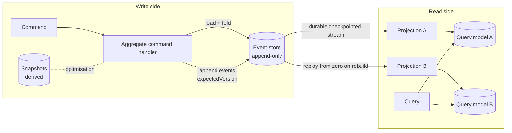

# Reference architecture — topology

The CQRS + event-sourcing topology this pack carries. Language-neutral and
store-product-neutral: "the event store" is the abstract append-only stream.

## Diagram

## Two sides, one stream

- The **write side** turns commands into immutable events. The aggregate command
  handler (`../patterns/aggregate-command-handler.md`) folds the stream, decides,
  and appends with optimistic concurrency by version
  (`../patterns/event-store.md`). It exposes **no query path**.
- The **read side** is one or more projections that consume the event stream and
  maintain disposable query models (`../patterns/projection-rebuild.md`). All reads
  go through a query model; querying the write side is prohibited.
- The two sides are **eventually consistent**: a projection lags the store by its
  processing latency (`projection_lag`,
  `../observability/required-signals.md`).

## Flow

1. A command reaches the **aggregate command handler**, which folds the aggregate's
   stream to current state and version.
2. The handler **appends** new events asserting `expectedVersion`; a conflict
   triggers reload-and-retry.
3. Each **projection** durable-pulls the stream from its checkpoint
   (`../broker/projection-consumer.md`), applies events idempotently, and commits
   its checkpoint atomically with the projection write.
4. A projection is **rebuilt** by replaying the stream from zero into a fresh
   model, then cutting reads over.

## ADRs (binding)

- **events-immutable** — a stored event is never edited or deleted in place;
  corrections are appended.
- **read-models-disposable** — a read model carries no authority and can be
  dropped and rebuilt from zero.
- **eventual-consistency-between-sides** — the read side lags the write side;
  clients tolerate that lag.
