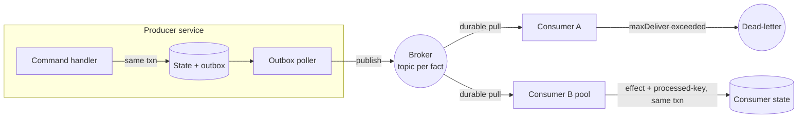

# Reference architecture — topology

The producer/consumer topology this pack carries. Language-neutral and
broker-product-neutral: "the broker" is the abstract platform transport.

## Diagram

## Bounded context per stream

- Each **bounded context** owns its aggregates and the events they emit. A topic
  belongs to exactly one producing context (`../events/topic-naming.md`).
- A consumer subscribes to the topics it needs across contexts; it never reaches
  into another context's database. The event is the only contract between them.
- Two services that need request/response coupling do not belong on this axis —
  model that boundary with the request/response architecture pack instead.

## Flow

1. A command handler applies a state change and records the event in the **outbox**
   in one transaction (`../patterns/outbox.md`).
2. The **outbox poller** publishes outbox rows to the broker, in per-aggregate
   order.
3. Consumers **durable-pull** (`../broker/consumer-good-practice.md`), apply their
   effect idempotently (`../patterns/idempotency.md`), and ack after commit.
4. A message past its redelivery budget is **dead-lettered** for deliberate replay
   (`../patterns/dead-letter-replay.md`).

## ADRs (binding)

- **async-first** — inter-service communication is asynchronous by default.
- **at-least-once-delivery** — the broker may redeliver; consumers tolerate it.
- **consumer-idempotency-required** — every consumer is idempotent on the event id.
