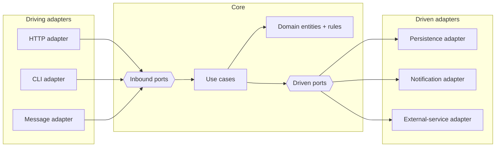

# Reference architecture — topology

The ports-and-adapters topology this pack carries. Language-neutral and
framework-neutral: every external system is reached only through a port the core
owns. The defining property of the diagram is that **every arrow points inward**.

## Diagram

## The dependency rule

- Arrows point **inward**. Driving adapters depend on the core's **inbound ports**;
  driven adapters implement the core's **driven ports**; the core depends only on the
  ports it owns. Nothing the core touches depends on an adapter.
- A **driving adapter** turns an external trigger (a request, a command, a message)
  into a call on an inbound port (`../patterns/use-case.md`).
- A **driven adapter** implements a driven port against an external system
  (`../patterns/repository-port.md`, `../patterns/dependency-inversion.md`), translating
  shapes (`../boundary/dto-mapping.md`) and errors (`../boundary/error-translation.md`)
  at the edge.
- **Messaging, when present, is just one driven (or driving) adapter** behind a port —
  not a pack-level broker concern. There is no `brokerClientPractice` here.

## Flow

1. A **driving adapter** receives an external trigger and translates it to a domain
   request, then invokes an **inbound port**.
2. The **use case** orchestrates domain entities and calls **driven ports** for any
   external work; it depends on ports only, never on a concrete adapter.
3. **Driven adapters** fulfil the driven ports against external systems, translating
   DTOs and errors at the boundary.
4. **Signals are emitted at the adapters** (`../observability/required-signals.md`);
   the core stays uninstrumented and pure.

## ADRs (binding)

- **domain-depends-on-nothing** — the core imports no adapter and no framework type.
- **adapters-depend-on-ports** — every adapter depends on a port the core owns.
- **instrument-at-adapters-only** — observability is emitted at boundaries; the core
  stays uninstrumented.
