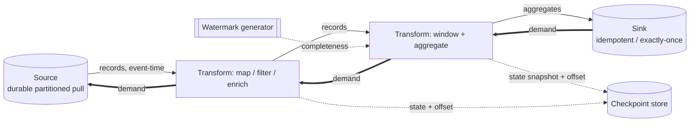

# Reference architecture — topology

The source → transform stages → sink topology this pack carries. Language-neutral
and engine-product-neutral: "the stream runtime" is the abstract platform that
wires and runs the stages.

## Diagram

Solid arrows are records flowing downstream; dashed arrows are checkpoint
commits; double arrows are **demand** flowing upstream (backpressure).

## Stages

- The **source** durable-pulls records from an unbounded or bounded stream,
  partition by partition, at the rate downstream demand allows
  (`../broker/stream-consumer-good-practice.md`).
- **Stateless transforms** (map, filter, enrich) reshape records one at a time;
  they hold no state and checkpoint only their offset.
- **Stateful transforms** (window, aggregate, join) bound their state with a
  window (`../patterns/windowing.md`), decide completeness from a watermark
  (`../patterns/watermarking.md`), and snapshot state with their offset at each
  checkpoint (`../patterns/checkpointing.md`).
- The **sink** writes results out idempotently, or commits exactly-once on the
  checkpoint barrier (`../patterns/idempotent-sink.md`).

## Flow

1. The source pulls records at the rate downstream can absorb; demand throttles it
   (`../patterns/backpressure.md`).
2. Records pass through transforms; stateful stages assign records to windows and
   advance the watermark.
3. A window closes and emits when the watermark passes its end plus allowed
   lateness.
4. Every stage commits state and offset atomically to the **checkpoint store**;
   on restart it restores both and resumes from the committed offset.

## ADRs (binding)

- **delivery-guarantee** — at-least-once with idempotent sinks, or exactly-once
  via checkpoints; each stage declares which.
- **event-time-over-processing-time** — aggregation is keyed on event-time with
  watermarks by default.
- **checkpointed-progress** — a restarted stage resumes from its last committed
  checkpoint, never from the start of the stream.
