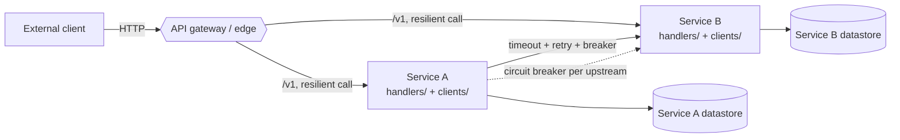

# Reference architecture — topology

The edge/gateway-plus-services topology this pack carries. Language-neutral and
client-product-neutral: "the service client" is the abstract resilient transport.

## Diagram

Each cross-service edge carries a **timeout, a retry budget, and a circuit breaker**
(`../patterns/resilience.md`). Each service owns its **own** datastore — `DB1` and
`DB2` are never shared (`one-service-one-datastore`).

## Edge and services

- The **API gateway / edge** is the single entry point for external clients: it
  authenticates, rate-limits, and routes to the owning service (`api-gateway-edge`,
  recommended). External clients never call internal services directly.
- A **service** owns a bounded slice of the domain and its datastore. It exposes a
  versioned API (`../api/versioning.md`) and reaches data it does not own by **calling
  the owning service** through `clients/`, never by reading another service's tables.
- A service that needs *fire-and-forget* coupling does not belong on this axis —
  model that boundary with the event-driven architecture pack instead.

## Flow

1. An external request enters through the **edge**, which authenticates and routes it.
2. A **handler** in the owning service serves the request, reading its own datastore.
3. When it needs data owned elsewhere, the handler makes a **resilient cross-service
   call** through a `clients/` wrapper — timeout, retry budget, circuit breaker,
   bulkhead (`../patterns/resilience.md`).
4. A **write** that the resilience layer may retry is **idempotent** on an idempotency
   key (`../patterns/idempotent-write.md`).

## ADRs (binding)

- **synchronous-by-default** — this axis serves request/response interactions; work
  that needs no answer belongs on the event-driven axis.
- **one-service-one-datastore** — each service owns its datastore; no two services
  share a database.
- **client-side-resilience-required** — every cross-service call has a timeout, a
  retry budget, and a circuit breaker.
