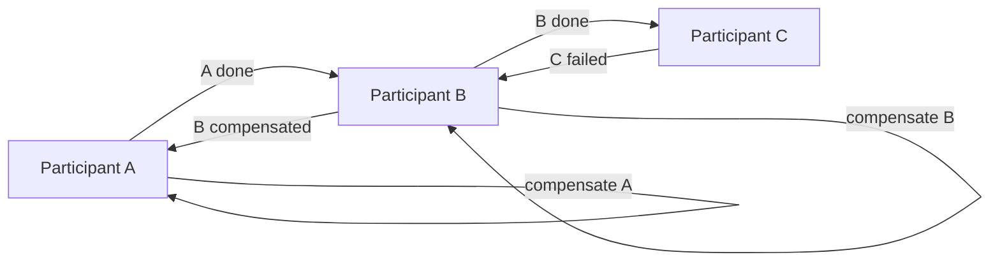

# Pattern — Choreographed saga

**Recommended.** `when:` the steps are loosely coupled and each can react to the
previous step's event without a central coordinator.

## Shape

There is no central coordinator. Each participant performs its local step and
emits an **event**; the next participant subscribes to that event, performs its
step, and emits its own. Failure flows the same way: a failing step emits a
failure event that triggers the prior participants' compensations.

## When to choose it

- The participants are loosely coupled and each can decide its own next action
  from an event, with no central policy to express.
- You want to avoid a single coordinator as a hot dependency; the saga logic is
  simple enough to distribute.
- The number of steps is small and the order is naturally linear.

## Rules

- Each participant still **persists its slice of saga state** keyed on `saga_id`
  (`saga-state.md`) so the distributed saga can be reconstructed for recovery.
- Each forward step still defines a **compensating action**
  (`compensation.md`); a failure event triggers the upstream compensations in
  reverse order.
- Correlation is by `saga_id` carried on every event (`../steps/contract.md`);
  participants never share a mutable record
  (`shared-mutable-state-across-saga-steps` anti-pattern).
- Choreography trades a central policy for emergent flow — prefer
  `orchestrated.md` when the step order or compensation logic is non-trivial.
