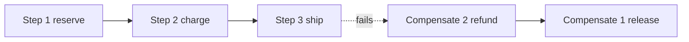

# Pattern — Compensating action

**Required.** `when:` a saga step has side effects that must be undone on failure.

## Problem

A saga applies its effects across several services, one local transaction at a
time. There is no distributed transaction to roll all of them back together. When
a later step fails, the effects of the earlier steps are already committed — an
order is reserved, a payment is authorised — and must be undone.

## Solution

Pair every forward step with a **compensating action** that semantically undoes
it. When a step fails (or its timeout / retry budget is exhausted,
`../steps/contract.md`), the saga runs the compensations for the steps that
already succeeded, in **reverse order**, then ends in a compensated state.

## Rules

- **Every forward step defines its compensation up front.** A step with an
  irreversible effect and no compensation is the
  `distributed-transaction-without-compensation` anti-pattern.
- **Compensations run in reverse order** of the steps they undo, so each undoes a
  state the system was actually in.
- **Compensations are idempotent and retried until acknowledged.** Delivery is at
  least once (`../steps/contract.md`); re-running a compensation on the same
  `saga_id` and step has the same effect as running it once.
- **Compensation is semantic, not a rollback.** It books an offsetting effect (a
  refund, a release) rather than reverting a transaction log — the original local
  transaction is already committed and visible.
- A compensation that itself fails its retry budget escalates to an operator
  alert (`../observability/required-signals.md`); it is never silently dropped.
