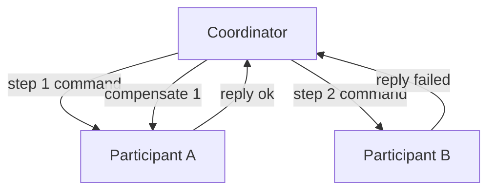

# Pattern — Orchestrated saga

**Recommended.** `when:` the step order and compensation logic are best owned by
a single explicit coordinator.

## Shape

A central **coordinator** owns the saga definition: the ordered steps, their
compensations, and the failure policy. It sends a command to each participant in
turn, waits for the reply, records the outcome in saga state
(`saga-state.md`), and decides whether to advance or compensate.

## When to choose it

- The step order and the failure / compensation policy are non-trivial and
  benefit from living in one place that can be read end to end.
- Steps change independently and the saga logic should not be scattered across
  every participant.
- You need a single owner for saga state, timeouts, and the in-flight count
  (`../observability/required-signals.md`).

## Rules

- The coordinator persists saga state on every transition (`saga-state.md`); it
  is the `orchestrator-without-persisted-state` anti-pattern if it does not.
- Communication is **command / reply** on the `saga_id`
  (`../steps/contract.md`); the coordinator never reaches into a participant's
  database.
- Each step command carries a bounded timeout and retry budget; on exhaustion the
  coordinator drives compensation (`compensation.md`).
- The coordinator is the obvious single point of failure — persisted state plus
  resume-on-restart, not a hot in-memory coordinator, is what keeps it safe.
