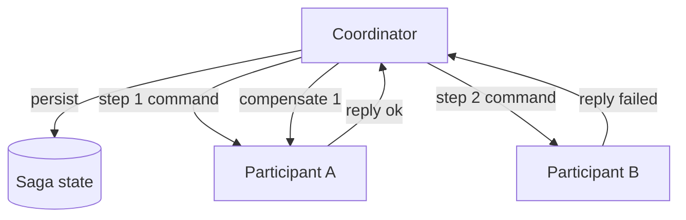
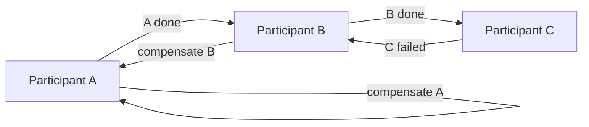

# Reference architecture — topology

The saga topology this pack carries, in both coordination shapes. Language-neutral
and product-neutral: "the coordinator" and "the broker" are abstract platform
components.

## Orchestrated

A central coordinator drives the steps and, on failure, the compensations. Saga
state is persisted so a restart resumes or compensates an in-flight saga.

## Choreographed

No coordinator: each participant reacts to the previous step's event and emits its
own; a failure event triggers the upstream compensations.

## Flow

1. A saga **starts**: the `saga_id` is generated and the initial saga state is
   persisted (`../patterns/saga-state.md`).
2. Each **step** is a local transaction at one participant, invoked by a command
   on the `saga_id` and answered by a reply (`../steps/contract.md`); every step
   is bounded by a timeout and retry budget.
3. On a **failed step** (or exhausted retries) the saga runs the
   **compensations** for the steps that already succeeded, in reverse order
   (`../patterns/compensation.md`), and ends compensated.
4. The saga ends **completed** (all steps succeeded) or **compensated** (a step
   failed and was rolled back); both are recorded in saga state and surfaced as
   signals (`../observability/required-signals.md`).

## ADRs (binding)

- **compensation-over-distributed-locks** — roll back by compensation, never by a
  distributed two-phase commit or cross-service lock.
- **persist-saga-state** — saga state is durable; a restart resumes or
  compensates in-flight sagas.
- **per-step-timeout-and-retry** — every external-participant step is bounded; on
  exhaustion the saga compensates, it does not hang.
