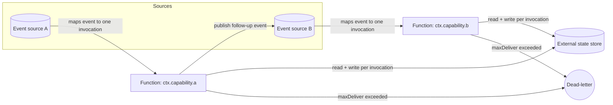

# Reference architecture — topology

The function-per-trigger topology this pack carries. Language-neutral and
platform-neutral: "the trigger source" is the abstract event source and "the
function runtime" is the abstract execution environment.

## Diagram

## One trigger, one function

- Each **event source** maps an event to exactly **one function invocation**
  (`../triggers/binding.md`). A function binds to one trigger type and owns one
  responsibility.
- Functions hold **no state between invocations**; the only durable state is the
  **external store**, read and written per invocation
  (`../patterns/stateless-handler.md`).
- Functions **do not call each other synchronously**. One function hands off to the
  next by publishing a follow-up event to a trigger source, keeping the handoff
  asynchronous and idempotent.
- A workload needing a long-lived process, request/response coupling, or in-memory
  state across requests does not belong on this axis — model that boundary with a
  different architecture pack.

## Flow

1. An **event source** delivers an event (at-least-once) and maps it to a single
   function invocation.
2. The **function** reads its state from the external store, applies one effect
   idempotently on the event id (`../patterns/idempotent-trigger.md`), writes the
   result back, and acks after the write commits.
3. If the function needs to trigger downstream work, it **publishes a follow-up
   event**; it never blocks on a synchronous call.
4. An event past its redelivery budget is **dead-lettered** for deliberate replay,
   never silently dropped.

## ADRs (binding)

- **stateless-handlers** — a function holds no state between invocations.
- **externalised-state** — durable state lives in an external store, read and
  written per invocation.
- **idempotent-triggers** — an event source may redeliver; every function is
  idempotent on the event id.
